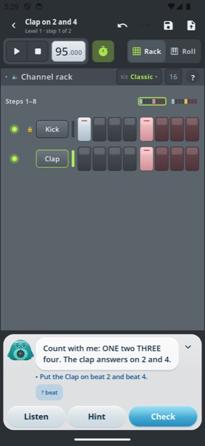
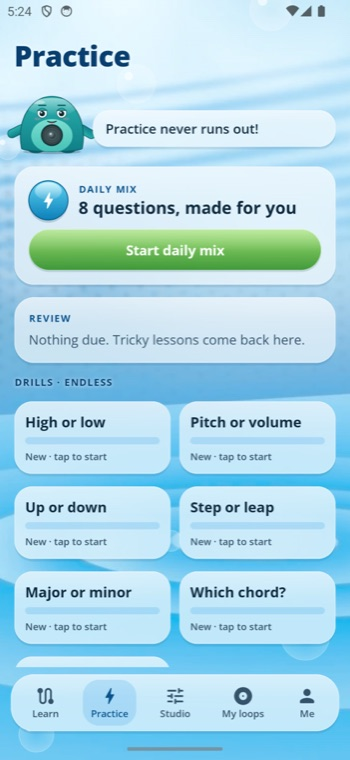
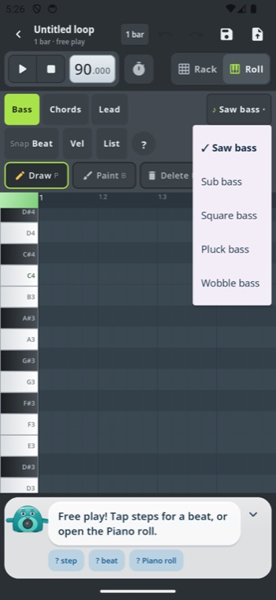
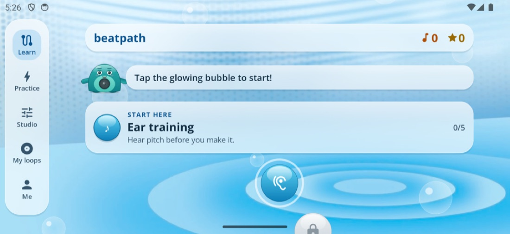
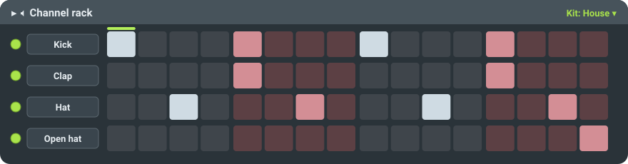

<div align="center">



<br>

<a href="../../releases/latest"></a>


**Bite-sized lessons that take you from *"what's a beat?"* to writing an 8-bar hook with harmony —<br>on a phone, in an FL Studio-style Channel Rack and Piano roll, with Lou as your guide.**

</div>

---

## 🎧 Meet Lou

<table>
<tr>
<td width="38%" align="center">

</td>
<td>

Lou is a little speaker-bellied creature who teaches every lesson. He **never lectures** — each step is one idea and one action:

1. 💡 **Today's idea** — the concept in one sentence (tap *Words & tips* for more)
2. 🎹 **Do it** — tap steps in the Channel Rack or draw notes in the Piano roll
3. ✅ **Check** — precise feedback: *"Note 3 should be higher than E5"*
4. 🆘 **Stuck?** — a 3-step hint ladder: a clue → gold outlines → the idea again in other words, then *↩ Back to the task*

Tap any music word in Lou's bubble (**? chord**, **? octave**…) and he explains it.

</td>
</tr>
</table>

## 📸 Screens

<div align="center">





<br><br>


</div>

## 🧠 What you learn

<div align="center">


</div>

| Track | Levels | You'll be able to… |
|---|---|---|
| 🥁 **Beats** | 1 · 3 · 5 | build kick/clap/hat grooves, swing, ghost notes, dynamics |
| 🎼 **Notes & keys** | 2 · 11 | read the Piano roll, C/G/F/D major, transpose a melody |
| 🎹 **Harmony** | 4 · 9 · 14 · 15 | triads, I–V–vi–IV, minor & modes, secondary dominants, borrowed chords |
| 🎤 **Melody** | 7 · 8 · 12 · 13 · 16 | motifs, contour, harmony lines, syncopation, triplets, development |
| 🔊 **Bass** | 6 | roots, octaves, 808 basics locked to the kick |
| 🎬 **Songwriting** | 10 · 17 · 18 | phrases, verse vs chorus, harmonise a tune, your own 8-bar hook |

**81 lessons** — 5 ear-training lessons + 76 Studio lessons in 18 levels, each ending with a jam and an FL Studio tip you can use on desktop.

## ⚡ Practice that never runs out *(new in 1.0)*

| | |
|---|---|
| 🎯 **Daily mix** | 8 ear questions, weighted toward the skills you miss most |
| 🔁 **Spaced review** | lessons you needed help with come back after 1, 3 and 7 days |
| ♾️ **Endless drills** | high/low · pitch vs volume · up/down · step/leap · major/minor · *which chord?* · **melody dictation** |
| 🏆 **Course complete** | finish all 81 → celebrate, then *Practice*, *Make a song* or *Redo for gold* |

## ✨ Feels like

- **Frutiger Aero** — sky-blue ripple artwork, floating bubbles, **frosted-glass** panels and buttons
- **Real FL Studio vocabulary** — Channel Rack (F6), Piano roll (F7), Draw P / Paint B / Delete D / Select E, snap, velocity, swing — drawn from scratch, no Image-Line assets
- **More sounds** — 4 drum kits (Classic, 808, House, Lo-fi) and 19 instrument presets (bell, flute, e-piano, strings, sub bass, wobble…), all synthesized on-device
- **Export** — MIDI straight into FL Studio (*Piano roll → File → Import MIDI file*), or WAV to share
- **Portrait & landscape**, smooth spring animations, lush Y2K sound effects, TalkBack labels everywhere

## 📲 Install

1. Download **`Beatpath-1.0.0.apk`** from [Releases](../../releases/latest)
2. Open it on your Android phone (8.1 or newer) and allow *install unknown apps* for your browser/files app
3. Start from zero — or tap *I already make beats* to unlock everything

No account, no ads, no network: progress and loops stay on your phone.

## 🛠️ Build from source

```bash
cd android
export JAVA_HOME="/Applications/Android Studio.app/Contents/jbr/Contents/Home"   # JDK 17+
./gradlew assembleDebug testDebugUnitTest
adb install -r app/build/outputs/apk/debug/app-debug.apk
```

Open any screen directly while developing:
`adb shell am start -S -n com.beatpath.app/.MainActivity --es route roll.four-chord-loop` (any lesson id, `practice`, `practice.mix`, `home`, `studio`).

<details>
<summary><b>Under the hood</b></summary>

- **Kotlin + Jetpack Compose**, single activity, no third-party runtime dependencies
- **Audio engine** — low-latency `AudioTrack`, event scheduler (16ths, triplets, swing), polyBLEP subtractive synth with a Cytomic SVF filter, synthesized drum kits, Freeverb-style reverb, offline render for WAV
- **Lessons are data** — each step has Lou's line, one task, ghost outlines, a hint ladder and a `check(project) → Verdict` function
- **Practice** — generated ear items, melody dictation lessons and a spaced-review scheduler (pure Kotlin, unit-tested)
- **27 unit tests** — every lesson's setup & checks, MIDI export, sound presets, practice generators and review schedule
- **UI checks** — scripts in `android/tools/ui-check/` launch every lesson in both orientations and audit tap targets

</details>

## 🗺️ Roadmap

Real-phone latency & audio focus → content packs (chord voicings, Ear training II, genre grooves) → Song mode → Play Store. See **[BUILD-PLAN.md](BUILD-PLAN.md)** — including a step-by-step guide to **adding your own lessons**.

---

<div align="center">
<sub>Beatpath is an independent learning project. FL Studio is a trademark of Image-Line; this app is not affiliated with or endorsed by Image-Line. All UI is original.</sub>
</div>
