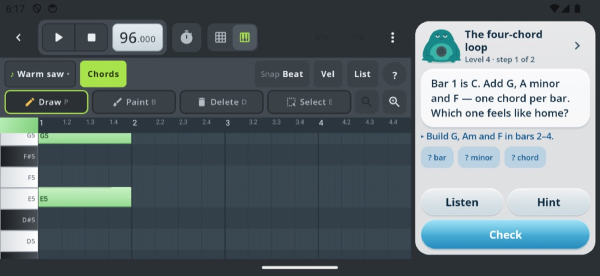

<div align="center">


<br>

<a href="../../releases/latest"></a>


Beatpath is an Android app that teaches music theory and melody writing in short lessons, from your first beat to an 8-bar hook with harmony. You work in a Channel Rack and Piano roll modeled on FL Studio, and a character called Lou walks you through each step.

</div>

## Meet Lou

<table>
<tr>
<td width="38%" align="center">

</td>
<td>

Lou is a small creature with a speaker for a belly, and he runs every lesson. Each step asks you to do one thing:

1. A card gives the lesson's idea in one sentence. Tap *Words & tips* for definitions and an FL Studio tip.
2. You tap steps in the Channel Rack or draw notes in the Piano roll.
3. *Check* tells you exactly what's off, for example *"Note 3 should be higher than E5"*.
4. If you're stuck, *Hint* gives a clue first, then gold outlines where the notes go, then the idea again in other words. *↩ Back to the task* brings the instructions back.

Music words in Lou's speech bubble turn into chips such as *? chord* and *? octave*. Tap one and Lou explains the word.

</td>
</tr>
</table>

## Screenshots

<div align="center">


<br><br>


</div>

## What you learn

<div align="center">


</div>

| Track | Levels | Topics |
|---|---|---|
| Beats | 1, 3, 5 | kick, clap and hat grooves, swing, ghost notes, dynamics |
| Notes and keys | 2, 11 | reading the Piano roll, C, G, F and D major, transposing a melody |
| Harmony | 4, 9, 14, 15 | triads, I-V-vi-IV, minor keys and modes, secondary dominants, borrowed chords |
| Melody | 7, 8, 12, 13, 16 | motifs, contour, harmony lines, syncopation, triplets, developing a melody |
| Bass | 6 | roots, octaves, 808 basics that lock to the kick |
| Songwriting | 10, 17, 18 | phrases, verse and chorus, harmonizing a tune, writing an 8-bar hook |

There are 81 lessons: 5 ear-training lessons, then 76 Studio lessons in 18 levels. Each level ends with a jam, and each lesson ends with a tip you can try in FL Studio on a computer.

## Practice (new in 1.0)

The Practice tab generates its exercises, so it keeps going after the last lesson.

- Daily mix: 8 ear-training questions, with more of the skills you get wrong.
- Review: lessons you needed help with come back after 1, 3 and 7 days, until you pass them on your own.
- Drills: high or low, pitch or volume, up or down, step or leap, major or minor, which chord, and melody dictation, where you hear four notes and write them in the Piano roll.

When you finish all 81 lessons, the Learn path offers Practice, a blank 4-bar song, or a redo of the lessons you passed with help.

## The app

- The look is Frutiger Aero: a sky-blue ripple background with floating bubbles, and frosted-glass panels and buttons.
- The Studio uses FL Studio's names and shortcuts: Channel Rack (F6), Piano roll (F7), Draw (P), Paint (B), Delete (D), Select (E), snap, velocity and swing. The graphics are drawn from scratch; none come from Image-Line.
- The phone synthesizes every sound: 4 drum kits (Classic, 808, House, Lo-fi) and 19 instrument presets, among them bell, flute, e-piano, strings, sub bass and wobble bass.
- You can export a loop as MIDI and open it in FL Studio (*Piano roll → File → Import MIDI file*), or as a WAV file to share.
- Every screen has a portrait and a landscape layout, and the controls have TalkBack labels.

## Install

1. Download `Beatpath-1.0.0.apk` from [Releases](../../releases/latest).
2. Open it on an Android phone running 8.1 or newer. Your browser or Files app may ask for permission to install unknown apps.
3. Tap *Start from zero*, or *I already make beats* to unlock every lesson.

The app needs no account or network connection and has no ads. Your progress and loops stay on the phone.

## Build from source

```bash
cd android
export JAVA_HOME="/Applications/Android Studio.app/Contents/jbr/Contents/Home"   # JDK 17+
./gradlew assembleDebug testDebugUnitTest
adb install -r app/build/outputs/apk/debug/app-debug.apk
```

To open a screen directly while developing, pass its route:
`adb shell am start -S -n com.beatpath.app/.MainActivity --es route roll.four-chord-loop`. Routes include any lesson id, `practice`, `practice.mix`, `home` and `studio`.

<details>
<summary>How it's built</summary>

- Kotlin and Jetpack Compose in a single activity. The only libraries are AndroidX and Compose.
- The audio engine plays through a low-latency `AudioTrack`. It has an event scheduler (sixteenths, triplets, swing), a polyBLEP subtractive synth with a Cytomic SVF filter, synthesized drums, a Freeverb-style reverb, and offline rendering for WAV export.
- Each lesson step is data: Lou's line, one task, ghost outlines, a hint ladder and a `check(project) → Verdict` function.
- Practice items, dictation lessons and the review schedule are generated in plain Kotlin.
- 27 unit tests cover every lesson's setup and checks, MIDI export, the sound presets, the practice generators and the review schedule.
- Scripts in `android/tools/ui-check/` open every lesson in both orientations and check tap targets.

</details>

## Roadmap

Next: measure audio latency on real phones and pause for calls (audio focus). After that come content packs (chord voicings, Ear training II, genre grooves), a Song mode, and a Play Store release. [BUILD-PLAN.md](BUILD-PLAN.md) has the details, including how to add your own lessons.

<div align="center">
<sub>Beatpath is an independent learning project. FL Studio is a trademark of Image-Line. Beatpath is not affiliated with or endorsed by Image-Line, and all of its UI is original.</sub>
</div>
