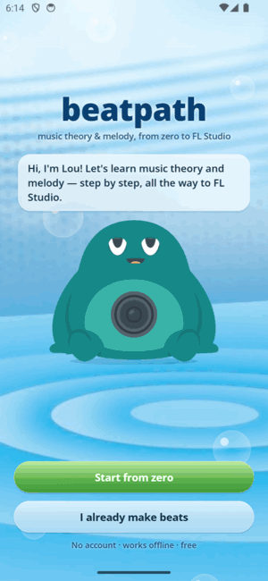
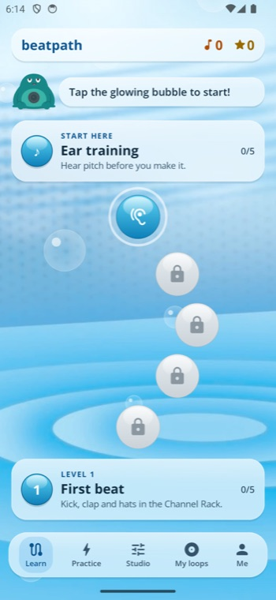
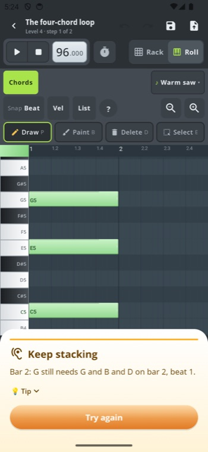

<div align="center">


<br>

<a href="../../releases/latest"></a>


Beatpath is an Android app that teaches music from the very first note: what a note is, how to find it, how chords and melodies work, and then how to make beats and songs in a Channel Rack and Piano roll modeled on FL Studio. A character called Lou walks you through every step, and everything is written so an 8-year-old can follow it.

</div>

## Meet Lou

<table>
<tr>
<td width="38%" align="center">

</td>
<td>

Lou is a small creature with a speaker for a belly, and he runs every lesson. Each step asks you to do one thing:

1. A card gives the lesson's idea in one sentence. Tap *Words & tips* for the music words in it.
2. You tap steps in the Channel Rack or draw notes in the Piano roll.
3. *Check* tells you exactly what's off, for example *"Note 3 should be higher than E5"*.
4. If you're stuck, *Hint* gives a clue first, then gold outlines where the notes go, then the idea again in other words. *↩ Back to the task* brings the instructions back.

Music words in Lou's speech bubble turn into chips such as *? chord* and *? octave*. Tap one and Lou explains the word.

</td>
</tr>
</table>

Lou in the app is drawn from the same artwork as the banner ([docs/lou.svg](docs/lou.svg)). He has ten moods. He breathes, blinks, looks around and sways his hands and feet, his speaker pumps on the beat, and if you try to leave a lesson he gets sad and sheds a tear.

## Screenshots

<div align="center">





<br><br>


</div>

## What you learn

<div align="center">


</div>

| Track | Levels | Topics |
|---|---|---|
| Beats | 1, 3, 5 | kick, clap and hat grooves, swing, ghost notes, dynamics |
| Notes and keys | 2, 11 | reading the Piano roll, C, G, F and D major, transposing a melody |
| Harmony | 4, 9, 14, 15 | triads, I-V-vi-IV, minor keys and modes, secondary dominants, borrowed chords |
| Melody | 7, 8, 12, 13, 16 | motifs, contour, harmony lines, syncopation, triplets, developing a melody |
| Bass | 6, 21 | roots, octaves, 808 basics that lock to the kick, walking up, octave bass |
| Songwriting | 10, 17, 18 | phrases, verse and chorus, harmonizing a tune, writing an 8-bar hook |
| Voicings | 19 | inversions, open chords, keeping the shared note, smooth chord changes |
| Genres | 20 | lo-fi, house, trap, pop and drum and bass grooves, each with its own kit and tempo |
| Melody III | 22 | call and response, countermelodies, one high point, ending at home |

There are 125 lessons:
- 16 Music basics lessons
- 5 ear-training lessons
- 98 Studio lessons in 22 levels
- 6 Ear training II lessons, after level 10

Each level ends with a jam. Every lesson was reviewed so it only uses ideas taught before it, explains each new word the first time, and stays short.

## Music basics

Before any FL screen, 16 short lessons teach the theory on a tappable keyboard where every note has a rainbow color (C red, D orange, E yellow, F green, G blue, A indigo, B violet).

- Part 1, notes and the keyboard: what a note is, the 7 letters, finding any key from the black-key groups, octaves, half and whole steps, sharps and flats, counting half steps (C + 4 = E), and the major scale rule W W H W W W H.
- Part 2, how notes fit together: scale numbers and home, intervals, building chords (take, skip, take), major and minor as 4 + 3 and 3 + 4, the chords in a key (I ii iii IV V vi), which note to play next, beats and note lengths, and finally the keyboard turned on its side: the Piano roll.

The same colors carry into the Studio Piano roll (🌈 in its toolbar). The sources behind the theory are in [research/basics-research.md](research/basics-research.md).

## Mini games (new in 1.2)

The Studio tab is now for playing and making music. The lessons stay on the Learn path. Lou stars in five games, and each one trains a real skill:

| Game | What you do | What it teaches |
|---|---|---|
| Sky Hop | Lou plays two notes, and you choose the cloud the second note went to. Later rounds use small steps and big leaps. | hearing up, down and the same |
| Beat Run | Lou runs to a drum, and you tap to jump as each block reaches him, right on the beat. Later rounds add the "and" between beats and speed up. | keeping a steady beat |
| Balloon Pop | Note balloons float up, and you pop each one by tapping its key. The key letters, then the colors, fade away as you improve, and sharps join in. | note names on the keyboard |
| Chord Cake | Chef Lou takes chord orders. Tap three keys to stack the cake, bottom note first. | building major and minor chords |
| Echo Lou | Lou hops across five rainbow pads singing a tune that grows, and you repeat it. | remembering melodies |

Games give 1 to 3 stars, keep your best score and earn XP.

## Song maker (new in 1.2)

Make loops A, B and C, then tap bars in the song row to arrange them. Switch Play to *Whole song* and export the full song as MIDI or WAV.

## XP, quests and Lou's Shop

Lessons, practice and mini games earn XP.

- Quests: every day brings three, for example "Play 2 mini games" or "Finish a lesson". Each one pays a reward when you claim it.
- Streak chests: keep practicing 3, 7, 14 and 30 days in a row to open a bonus chest.
- Levels: your level and title (Beginner, Beat maker, Melody maker, up to Hitmaker) come from all the XP you've ever earned. Spending never lowers them.

Unspent XP goes to Lou's Shop. Lou stands on a clay stage there, and you tap any item to try it on before you buy it. Items have rarities from common to legendary:

- Hats: party hat, cool cap, beanie, chef hat, studio headphones, flower crown, wizard hat, crown
- Glasses: fancy mustache, shades, star glasses, heart glasses, monocle
- Extras: bow tie, scarf, gold chain
- Colors: coral, mint, grape, bubblegum, sunny, midnight, and a rainbow Lou that cycles through the note colors
- Mystery box: a random item you don't own yet

Lou wears what you pick everywhere in the app.

## Practice (new in 1.0)

The Practice tab generates its exercises, so it keeps going after the last lesson.

- Daily mix: 8 ear-training questions, with more of the skills you get wrong.
- Review: lessons you needed help with come back after 1, 3 and 7 days, until you pass them on your own.
- Drills: high or low, pitch or volume, up or down, step or leap, major or minor, which chord, and melody dictation, where you hear four notes and write them in the Piano roll.

When you finish all 125 lessons, the Learn path offers Practice, a blank 4-bar song, or a redo of the lessons you passed with help.

## The app

- Everything is soft clay on a sky-blue background with floating bubbles. Clay cards, buttons, chips and switches all squish onto a darker base when you press them, with soft lighting and a fine grain. The FL-style windows (Channel Rack, Piano roll, transport, tools) keep FL's own flat look. On the path, finished lessons show a green clay tick and playable ones an orange clay star.
- Nothing on screen jumps after you press Check. The result tray slides in and out smoothly, and the right answer lights up after a miss.
- Music stops for phone calls, other apps and unplugged headphones. *Calm motion* in the Me tab turns the floating bubbles off and keeps Lou still.
- The Studio uses FL Studio's names and shortcuts: Channel Rack (F6), Piano roll (F7), Draw (P), Paint (B), Delete (D), Select (E), snap, velocity and swing. The graphics are drawn from scratch; none come from Image-Line.
- The phone synthesizes every sound: 4 drum kits (Classic, 808, House, Lo-fi) and 19 instrument presets, among them bell, flute, e-piano, strings, sub bass and wobble bass.
- You can export a loop or a whole song as MIDI and open it in FL Studio (*Piano roll → File → Import MIDI file*), or as a WAV file to share.
- Every screen has a portrait and a landscape layout, and the controls have TalkBack labels.

## Install

1. Download `Beatpath-1.2.0.apk` from [Releases](../../releases/latest).
2. Open it on an Android phone running 8.1 or newer. Your browser or Files app may ask for permission to install unknown apps.
3. Tap *Start from zero*, or *I already make beats* to unlock every lesson.

The app needs no account or network connection and has no ads. Your progress and loops stay on the phone. See [PRIVACY.md](PRIVACY.md).

## Build from source

```bash
cd android
export JAVA_HOME="/Applications/Android Studio.app/Contents/jbr/Contents/Home"   # JDK 17+
./gradlew assembleDebug testDebugUnitTest
adb install -r app/build/outputs/apk/debug/app-debug.apk
```

To open a screen directly while developing, pass its route:
`adb shell am start -S -n com.beatpath.app/.MainActivity --es route roll.four-chord-loop`. Routes include any lesson id, any game id (`game.skyhop`, `game.beatrun`, `game.balloons`, `game.chordcake`, `game.echo`), `games`, `shop`, `practice`, `practice.mix`, `home` and `studio`.

<details>
<summary>How it's built</summary>

- Kotlin and Jetpack Compose in a single activity. The only libraries are AndroidX and Compose.
- The audio engine plays through a low-latency `AudioTrack`. It has an event scheduler (sixteenths, triplets, swing), a polyBLEP subtractive synth with a Cytomic SVF filter, synthesized drums, a Freeverb-style reverb, and offline rendering for WAV export.
- Each lesson step is data: Lou's line, one task, ghost outlines, a hint ladder and a `check(project) → Verdict` function.
- Practice items, dictation lessons and the review schedule are generated in plain Kotlin.
- 44 unit tests cover every lesson's setup and checks (right answers pass, wrong and empty ones fail), every Music basics and Ear training II answer and its theory, the new packs' wording rules, the shop and level math, MIDI export, the sound presets, the practice generators and the review schedule.
- Scripts in `android/tools/ui-check/` open every lesson in both orientations. `walk.py` plays each lesson like a child: it asks for a hint, answers wrong, retries, then tries to leave and checks that sad Lou asks first and that it lands back on the path.

</details>

## Roadmap

Done in 1.2: mini games, the song maker, quests and streak chests, the bigger shop, four content packs, Ear training II, audio focus and the clay look. Next: measure audio latency on real phones, then the Play Store release (it needs the owner's signing key and developer account). The store text is drafted in [docs/play-store-listing.md](docs/play-store-listing.md). [BUILD-PLAN.md](BUILD-PLAN.md) has the details, including how to add your own lessons.

<div align="center">
<sub>Beatpath is an independent learning project. FL Studio is a trademark of Image-Line. Beatpath is not affiliated with or endorsed by Image-Line, and all of its UI is original.</sub>
</div>
